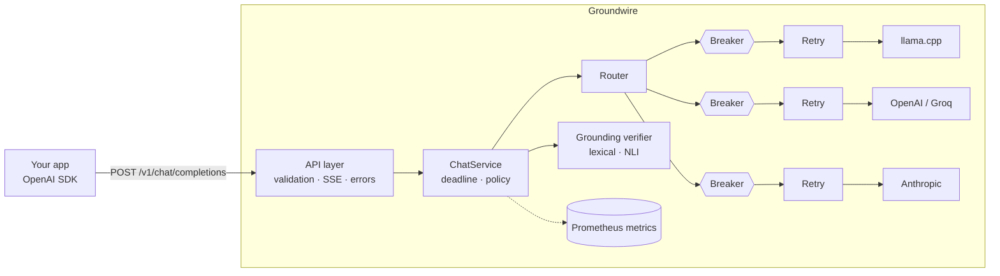

# Groundwire

**A self-hosted, OpenAI-compatible LLM gateway that keeps answers available and honest.**

Groundwire sits between your application and any LLM, local or cloud. Point an
OpenAI SDK at it by changing one URL, and every call gets:

- **Failover across providers**: local llama.cpp first, cloud only if needed.
- **Retries with jittered backoff** and **per-provider circuit breakers**.
- **End-to-end deadlines**, so a slow upstream can't hang your app.
- **Grounding verification**: checks the answer against the context you supplied
  and flags or blocks unsupported claims (invented amounts, dates, IDs).
- **Structured JSON logs** with request IDs, and **Prometheus metrics**.

Runs fully offline on a laptop CPU. No GPU, no cloud account required.

---

## Architecture



**Layering (ports and adapters):**

| Layer | Package | Knows about |
|---|---|---|
| HTTP | `api/` | FastAPI, SSE framing, status codes |
| Use case | `services/` | Deadlines, grounding policy, metrics |
| Routing | `routing/` | Fallback chains, breakers, retries |
| Resilience | `resilience/` | Backoff math, breaker state machine |
| Guardrails | `guardrails/` | Claim splitting, support scoring |
| Adapters | `providers/` | Vendor wire formats, error classification |
| Core | `core/`, `domain/` | Config, errors, logging, models |

Dependencies point inward. Adding a vendor means writing one adapter and one
line in `providers/factory.py`.

---

## Quick start

```bash
git clone https://github.com/apmg001/groundwire.git && cd groundwire
python -m venv .venv && source .venv/bin/activate
pip install -e ".[dev]"

make check     # ruff + mypy --strict + pytest with coverage
make run       # gateway on http://127.0.0.1:8000
```

Try the built-in `demo` route (two in-process mock providers, one of which fails 50% of the time):

```bash
curl -s localhost:8000/v1/chat/completions \
  -H 'content-type: application/json' \
  -d '{"model": "demo", "messages": [{"role": "user", "content": "hi"}]}'
```

The response includes a `groundwire` block showing which provider answered and every attempt made.

### With a real local model (llama.cpp, CPU)

```bash
# Download a small quantized model, e.g. Qwen2.5-3B-Instruct Q4_K_M (~2 GB)
llama-server -m qwen2.5-3b-instruct-q4_k_m.gguf --port 8080 -t 6
make run
curl -s localhost:8000/v1/chat/completions -H 'content-type: application/json' \
  -d '{"messages": [{"role": "user", "content": "Explain circuit breakers in one line."}]}'
```

To add cloud fallbacks, export the key and set `enabled: true` for that provider in `config/groundwire.yaml`.

### Docker

```bash
docker compose up --build     # gateway :8000, Prometheus :9090
```

---

## Using it from an OpenAI SDK

```python
from openai import OpenAI

client = OpenAI(base_url="http://localhost:8000/v1", api_key="unused")

context = ["Order 7781 was refunded 49.99 USD on 2 May."]
response = client.chat.completions.create(
    model="default",  # a route alias from the config
    messages=[
        {"role": "system", "content": "Answer only from this context:\n" + context[0]},
        {"role": "user", "content": "How much was refunded for order 7781?"},
    ],
    extra_body={"groundwire": {"grounding": {"context": context, "mode": "block"}}},
)
print(response.choices[0].message.content)
```

With `mode: "block"`, an answer that cites an amount not present in the context
is refused with HTTP 422 and a per-claim report. With `mode: "flag"` (default),
the answer is returned with the report attached.

---

## How the fault tolerance works

| Failure | Behaviour |
|---|---|
| Timeout, connection error, 5xx, 529, 429 | Retried on the same provider with full-jitter backoff (honours `Retry-After`, capped), then fail over |
| 401 / 403 | No retry (won't fix itself); fail over; counts against the breaker |
| 400 / 404 / 422 from upstream | Surfaced to the client as 400; **no** failover (the request itself is bad) |
| Provider keeps failing | Circuit opens after N consecutive failures; calls skip it instantly (no timeout cost) until a half-open probe succeeds |
| Every provider down | HTTP 503 with a record of each attempt |
| Too slow overall | HTTP 504 when `request_timeout_s` expires, across all retries and failover |
| Client disconnects | Upstream call cancelled; breaker probe slot released without a verdict |
| Grounding scorer crashes | `fail_open` → answer marked `unverified`; `fail_closed` → 503 |

**Streaming:** failover happens only before the first chunk is sent. After
that, a provider failure is delivered in-band as an SSE `error` payload rather
than silently switching models mid-sentence.

---

## Grounding scorers

| Scorer | Install | Catches | Misses |
|---|---|---|---|
| `lexical` (default) | nothing | Invented numbers, amounts, dates, times and IDs; claims with little overlap with the context | Paraphrased contradictions ("did" vs "did not") |
| `nli` | `make install-nli` | Semantic entailment and contradiction (DeBERTa cross-encoder) | Weak on exact numbers; tens of ms per claim on CPU |
| `hybrid` | `make install-nli` | Both: a numeric gate rejects wrong numbers without running the model, NLI judges the rest | Slower than lexical |
| `token` | `make install-nli` | Reads the whole prompt and answer at once and marks each answer word as supported or made up. Default model: [LettuceDetect](https://github.com/KRLabsOrg/LettuceDetect) (ModernBERT, MIT), fine-tuned on RAGTruth | Slowest; trained on RAG-style prompts, so other domains may need checking |

Numbers are normalised before comparison (`1,200.00` = `1200`), and so are clock times (`5 pm` = `5:00 PM` = `17:0`).
Scoring is CPU-bound, so it runs in a worker thread behind a concurrency limit and never blocks the event loop.

---

## Benchmark: does the fact-checker actually work?

Measured on **[RAGTruth](https://github.com/ParticleMedia/RAGTruth)**: 2,700 real LLM answers to
retrieval-augmented prompts (question answering, news summaries, and descriptions written from
business data), each labelled by human annotators as hallucinated or not.

The benchmark runs the **same verifier the gateway uses**. A response is flagged when its answer
score (claim scores combined by the configured aggregation) falls below a threshold. Thresholds are
either tuned on the *train* split and applied unchanged to *test*, or fixed in advance; never tuned
on the numbers they report.

### Headline: full RAGTruth test set (2,700 answers)

| Scorer | F1 | Precision | Recall | ROC-AUC | Good answers blocked | Latency p50 (laptop CPU) |
|---|---|---|---|---|---|---|
| `lexical` (rules, no model) | 64.4% | 52.8% | 82.6% | 0.783 | 39.7% | 3 ms |
| **`token`** (LettuceDetect-base) | **76.1%** | **76.6%** | 75.5% | **0.889** | **12.3%** | 975 ms |
| *Flag everything (baseline)* | *51.8%* | *34.9%* | *100%* | *0.5* | *100%* | – |

**Switching to the token scorer cut wrongly blocked good answers from 39.7% to 12.3%** while raising
F1 from 64.4% to 76.1%. It costs about a second per answer on a laptop CPU (Intel i5-1235U).

**Reproduction check.** LettuceDetect's paper reports 76.07% F1 for this model on the RAGTruth test
set (QA 65.52%, Data2txt 87.89%, Summary 50.52%). Groundwire, running it through its own
verifier pipeline, measured **76.1%** (QA 65.5%, Data2txt 87.9%, Summary 50.5%), matching to the first
decimal. That confirms the integration is faithful, not just "inspired by" the model.

> Fairness note: LettuceDetect was fine-tuned on the RAGTruth *train* split, so this is an
> in-distribution result; the test split is held out. Its benchmark uses the model's native 0.5
> threshold with no tuning. Expect lower accuracy on very different domains until measured there.

### Token scorer by task

| Task | Responses | Hallucinated | Precision | Recall | F1 | F1 if flagging everything | ROC-AUC | Good answers blocked | Latency p50 / p95 |
|---|---|---|---|---|---|---|---|---|---|
| **All tasks** | 2700 | 34.9% | 76.6% | 75.5% | **76.1%** | 51.8% | **0.889** | 12.3% | 975 / 2472 ms |
| QA | 900 | 17.8% | 60.6% | 71.2% | 65.5% | 30.2% | 0.901 | 10.0% | 725 / 1178 ms |
| Summary | 900 | 22.7% | 53.9% | 47.5% | 50.5% | 37.0% | 0.756 | 11.9% | 917 / 3380 ms |
| Data2txt | 900 | 64.3% | 89.3% | 86.5% | 87.9% | 78.3% | 0.904 | 18.7% | 1327 / 2324 ms |

Summaries remain the hardest case: it catches fewer than half of hallucinated summaries.

### Lexical scorer by task

Answer score = average of the two weakest claims (`lowest_two`), threshold tuned for best F1 on train:

| Task | Responses | Hallucinated | Precision | Recall | F1 | F1 if flagging everything | ROC-AUC | Good answers blocked | Latency p50 |
|---|---|---|---|---|---|---|---|---|---|
| **All tasks** | 2700 | 34.9% | 52.8% | 82.6% | **64.4%** | 51.8% | **0.783** | 39.7% | 3 ms |
| QA | 900 | 17.8% | 35.8% | 61.3% | 45.2% | 30.2% | 0.785 | 23.8% | 2 ms |
| Summary | 900 | 22.7% | 33.9% | 51.5% | 40.9% | 37.0% | 0.667 | 29.4% | 3 ms |
| Data2txt | 900 | 64.3% | 64.6% | 99.5% | 78.3% | 78.3% | 0.592 | 98.4% | 11 ms |

`--max-good-blocked` tunes the lexical threshold for a budget instead: at ≤ 20% good answers blocked
(15.4% on test) it catches 51.6% of hallucinations with 64.3% precision. Use it when latency
matters more than accuracy.

### How we got here

| Step | ROC-AUC | F1 | Good answers blocked | What changed |
|---|---|---|---|---|
| 1. Lexical, weakest claim decides | 0.735 | 63.5% | 34.8% | First measurement |
| 2. + clock-time fix, `lowest_two` | 0.783 | 64.4% | 39.7% (tunable) | Error analysis + better aggregation |
| 3. General NLI (`hybrid`), 300-answer sample | 0.708 | 61.6% | 50.0% | Worse, and ~1,000× slower |
| 4. General NLI, evidence-first, 300-answer sample | 0.677 | 56.3% | 78.6% | 10× faster than step 3, still worse |
| **5. Task-trained token classifier** | **0.889** | **76.1%** | **12.3%** | Model trained for exactly this job |

- **Judging by the weakest claim alone over-penalised long answers.** Averaging the two weakest was
  chosen because it scored best on a separate sample of 1,200 *train* answers, not by looking at test.
- **Error analysis found a real bug**: correct opening hours were rejected because `11 am` didn't
  match `11:0` in the source. Clock times are now normalised.
- **A general-purpose NLI model was the wrong tool.** `nli-deberta-v3-small` is trained on short
  sentence pairs; against long evidence it gave near-zero entailment to almost every claim, true
  or not (tuned thresholds collapsed to 0.0009 and 0.012). Evidence-first pairing fixed the speed
  but not the accuracy.
- **What worked was a model trained on this task**, which reads every passage and the whole answer
  at once and labels each answer token.

### Reproduce

```bash
make bench            # lexical, full test set, about a minute
make install-nli      # once: CPU-only torch + transformers
make bench-nli        # NLI, 100 answers per task, evidence-first
make bench-hybrid     # numeric gate + NLI, 100 answers per task, evidence-first
make bench-token      # LettuceDetect token classifier, full test set (slow on CPU)

# Tune for a "good answers blocked" budget instead of best F1
python -m groundwire.evals --per-task 0 --dev-per-task 200 --max-good-blocked 0.2
```

Each run writes `results/<timestamp>-<scorer>/` containing `report.md` (the table above),
`summary.json`, and `predictions.jsonl` with the weakest claim of every answer for error analysis.
See `python -m groundwire.evals --help` for sampling, label policy and threshold options.

---

## Operations

| Endpoint | Purpose |
|---|---|
| `GET /healthz` | Liveness: process is up. Never touches providers. |
| `GET /readyz` | Readiness: 503 if any route has every circuit open. |
| `GET /metrics` | Prometheus: requests, latency, attempts, failovers, circuit state, tokens, grounding verdicts. |
| `GET /v1/models` | Route aliases and their provider chains. |

Every response carries `X-Request-ID` (your own value is reused if you send
one) and `X-Groundwire-Provider`. All log lines for a request share its ID.

---

## Chaos demo

One command (starts a temporary gateway, runs the test, stops the gateway):

```bash
make demo
```

Or, against a gateway you started yourself:

```bash
make run          # terminal 1: keep this running
make chaos        # terminal 2
```

`make chaos` is only a client. If no gateway is running it stops immediately
with a hint instead of sending traffic.

Example run (in-process mocks; numbers measure gateway overhead, not model speed):

```
requests:       500 in 0.86s (583 req/s)
status codes:   {200: 500}
served by:      {'mock-flaky': 60, 'mock-stable': 440}
latency:        p50=64.8ms  p95=234.0ms  p99=324.3ms
circuit states: {'mock-flaky': 'open', 'mock-stable': 'closed'}
```

The primary fails 50% of the time, yet every request succeeds: retries absorb
some failures, the breaker opens and routes around the rest.

---

## Project layout

```
src/groundwire/
  api/            routes, ASGI middleware (request ID, body limit), error mapping
  services/       ChatService: deadline, grounding policy, metrics
  routing/        Router: fallback chains, failover, streaming handoff
  resilience/     RetryPolicy, CircuitBreaker
  guardrails/     text utils, scorers (lexical, NLI, hybrid), token detector, GroundingVerifier
  evals/          RAGTruth benchmark: loader, metrics, runner, report, CLI
  providers/      base port, OpenAI-compatible, Anthropic, mock, factory
  observability/  Prometheus metrics
  core/           config, errors, logging, request context
  domain/         OpenAI-compatible models
  container.py    composition root
  main.py         app factory and entrypoint
tests/            unit + integration (no network needed)
config/           gateway YAML (local and Docker variants)
scripts/          chaos demo
```

## Roadmap

- [x] Gateway core, streaming, failover, retries, circuit breakers, deadlines
- [x] Grounding verification (lexical, NLI, hybrid), flag/block policies
- [x] Reproducible RAGTruth benchmark with train-tuned thresholds
- [x] Metrics, structured logs, Docker, CI
- [ ] Semantic cache (embeddings + Redis/pgvector)
- [ ] Prompt-injection detection and PII redaction
- [x] NLI and hybrid benchmark results (negative result, documented)
- [x] Token-classifier (LettuceDetect) benchmark: 76.1% F1, reproduces the published result
- [ ] Eval harness with a CI regression gate
- [ ] OpenTelemetry tracing and Grafana dashboard
- [ ] Helm chart; shared (Redis-backed) breaker state across replicas

## License

MIT
