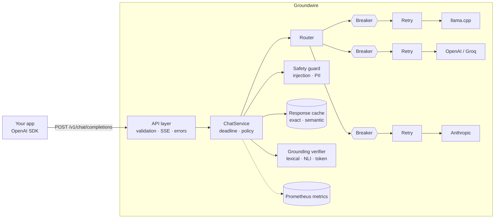

# Groundwire

**A self-hosted, OpenAI-compatible LLM gateway that keeps answers available and honest.**

Groundwire sits between your application and any LLM, local or cloud. Point an
OpenAI SDK at it by changing one URL, and every call gets:

- **Failover across providers**: local llama.cpp first, cloud only if needed.
- **Retries with jittered backoff** and **per-provider circuit breakers**.
- **End-to-end deadlines**, so a slow upstream can't hang your app.
- **Grounding verification**: checks the answer against the context you supplied
  and flags or blocks unsupported claims (invented amounts, dates, IDs).
- **Prompt-injection screening and PII redaction** before any model sees the request.
- **Exact + semantic response cache** with request coalescing: repeat and reworded
  questions are answered without a model call.
- **Cascade routing**: cheap model first, strong model only when the answer fails the
  fact-check (matched GPT-4's hallucination rate at ~15% of its cost on RAGTruth).
- **Structured JSON logs** with request IDs, and **Prometheus metrics**.

Runs fully offline on a laptop CPU. No GPU, no cloud account required.

---

## Architecture



**Layering (ports and adapters):**

| Layer | Package | Knows about |
|---|---|---|
| HTTP | `api/` | FastAPI, SSE framing, status codes |
| Use case | `services/` | Deadlines, grounding policy, metrics |
| Routing | `routing/` | Fallback chains, breakers, retries |
| Resilience | `resilience/` | Backoff math, breaker state machine |
| Guardrails | `guardrails/` | Claim splitting, support scoring |
| Safety | `safety/` | Injection rules/classifier, PII detection and vault |
| Cache | `cache/` | Keys, embeddings, store port + in-memory adapter, coalescing |
| Adapters | `providers/` | Vendor wire formats, error classification |
| Core | `core/`, `domain/` | Config, errors, logging, models |

Dependencies point inward. Adding a vendor means writing one adapter and one
line in `providers/factory.py`.

---

## Quick start

```bash
git clone https://github.com/apmg001/groundwire.git && cd groundwire
python -m venv .venv && source .venv/bin/activate
pip install -e ".[dev]"

make check     # ruff + mypy --strict + pytest with coverage
make run       # gateway on http://127.0.0.1:8000
```

Try the built-in `demo` route (two in-process mock providers, one of which fails 50% of the time):

```bash
curl -s localhost:8000/v1/chat/completions \
  -H 'content-type: application/json' \
  -d '{"model": "demo", "messages": [{"role": "user", "content": "hi"}]}'
```

The response includes a `groundwire` block showing which provider answered and every attempt made.

### With a real local model (llama.cpp, CPU)

```bash
# Download a small quantized model, e.g. Qwen2.5-3B-Instruct Q4_K_M (~2 GB)
llama-server -m qwen2.5-3b-instruct-q4_k_m.gguf --port 8080 -t 6
make run
curl -s localhost:8000/v1/chat/completions -H 'content-type: application/json' \
  -d '{"messages": [{"role": "user", "content": "Explain circuit breakers in one line."}]}'
```

To add cloud fallbacks, export the key and set `enabled: true` for that provider in `config/groundwire.yaml`.

### Docker

```bash
docker compose up --build     # gateway :8000, Prometheus :9090
```

---

## Using it from an OpenAI SDK

```python
from openai import OpenAI

client = OpenAI(base_url="http://localhost:8000/v1", api_key="unused")

context = ["Order 7781 was refunded 49.99 USD on 2 May."]
response = client.chat.completions.create(
    model="default",  # a route alias from the config
    messages=[
        {"role": "system", "content": "Answer only from this context:\n" + context[0]},
        {"role": "user", "content": "How much was refunded for order 7781?"},
    ],
    extra_body={"groundwire": {"grounding": {"context": context, "mode": "block"}}},
)
print(response.choices[0].message.content)
```

With `mode: "block"`, an answer that cites an amount not present in the context
is refused with HTTP 422 and a per-claim report. With `mode: "flag"` (default),
the answer is returned with the report attached.

---

## How the fault tolerance works

| Failure | Behaviour |
|---|---|
| Timeout, connection error, 5xx, 529, 429 | Retried on the same provider with full-jitter backoff (honours `Retry-After`, capped), then fail over |
| 401 / 403 | No retry (won't fix itself); fail over; counts against the breaker |
| 400 / 404 / 422 from upstream | Surfaced to the client as 400; **no** failover (the request itself is bad) |
| Provider keeps failing | Circuit opens after N consecutive failures; calls skip it instantly (no timeout cost) until a half-open probe succeeds |
| Every provider down | HTTP 503 with a record of each attempt |
| Too slow overall | HTTP 504 when `request_timeout_s` expires, across all retries and failover |
| Client disconnects | Upstream call cancelled; breaker probe slot released without a verdict |
| Grounding scorer crashes | `fail_open` → answer marked `unverified`; `fail_closed` → 503 |

**Streaming:** failover happens only before the first chunk is sent. After
that, a provider failure is delivered in-band as an SSE `error` payload rather
than silently switching models mid-sentence.

---

## Grounding scorers

| Scorer | Install | Catches | Misses |
|---|---|---|---|
| `lexical` (default) | nothing | Invented numbers, amounts, dates, times and IDs; claims with little overlap with the context | Paraphrased contradictions ("did" vs "did not") |
| `nli` | `make install-nli` | Semantic entailment and contradiction (DeBERTa cross-encoder) | Weak on exact numbers; tens of ms per claim on CPU |
| `hybrid` | `make install-nli` | Both: a numeric gate rejects wrong numbers without running the model, NLI judges the rest | Slower than lexical |
| `token` | `make install-nli` | Reads the whole prompt and answer at once and marks each answer word as supported or made up. Default model: [LettuceDetect](https://github.com/KRLabsOrg/LettuceDetect) (ModernBERT, MIT), fine-tuned on RAGTruth | Slowest; trained on RAG-style prompts, so other domains may need checking |

Numbers are normalised before comparison (`1,200.00` = `1200`), and so are clock times (`5 pm` = `5:00 PM` = `17:0`).
Scoring is CPU-bound, so it runs in a worker thread behind a concurrency limit and never blocks the event loop.

---

## Safety: prompt injection and PII

Two checks run on every request **before any model sees it** (configured under `safety:`).

**Prompt-injection screening.** User messages (direct attacks) and grounding documents
(indirect attacks hidden in retrieved content) are scanned. `block` returns HTTP 400
`prompt_injection_detected` and **no provider is called**; `flag` lets the request through and
reports findings in `groundwire.safety`.

| Detector | How | Trade-off |
|---|---|---|
| `heuristic` (default) | Weighted rules for instruction override, role hijack, system-prompt extraction, fake chat-template markers, data exfiltration via links, and text addressed to "the AI". Text is normalised first (Unicode NFKC, zero-width characters removed), so `ig\u200bnore previous instructions` still matches. | ~1 ms, explainable, but only knows the patterns it was written for |
| `classifier` | [`protectai/deberta-v3-base-prompt-injection-v2`](https://huggingface.co/protectai/deberta-v3-base-prompt-injection-v2) (Apache-2.0), long texts scored in overlapping windows | Generalises better; English only, model card advises against scanning system prompts |
| `both` | Maximum of the two | Best coverage |

**PII redaction.** Emails, phone numbers, card numbers (Luhn-checked), Aadhaar (Verhoeff-checked),
PAN and IPv4 addresses are replaced with placeholders in *every* message sent to providers, then
restored in the answer, including while streaming, where a placeholder can arrive split across chunks:

```
client  : "Refund rahul@example.com, card 4111 1111 1111 1111"
provider: "Refund [EMAIL_1], card [CARD_1]"
answer  : "Refund sent to [EMAIL_1]."  ->  client sees "Refund sent to rahul@example.com."
```

The same value always gets the same placeholder within a request, raw values are held only in
memory for that request, and only counts are logged.

**Limits, stated plainly:**

- **No filter prevents prompt injection.** Screening is one layer. The ones that matter more are
  architectural: keep decisions (refunds, permissions) in deterministic code, give the model least
  privilege, never put secrets in prompts, and check outputs (the grounding check above blocks
  unsupported claims an injected document tries to plant).
- **Regex PII detection covers structured identifiers only.** It does not reliably find names,
  addresses or business secrets. For data that must never leave your servers, route to local
  models only (`llama-local`, `ollama-local`); redaction is for when cloud models are allowed.

---

## Response cache: exact, semantic, coalesced

Configured under `cache:`. A lookup runs after PII redaction and before any provider call:

1. **Exact**: hash of the normalised question (case, spacing and trailing punctuation ignored).
   Always on and needs no extra dependencies.
2. **Semantic** (`semantic: true`, needs `make install-nli`): the question is embedded with
   [`all-MiniLM-L6-v2`](https://huggingface.co/sentence-transformers/all-MiniLM-L6-v2)
   (Apache-2.0, 22M params, CPU) and matched against earlier questions by cosine similarity.
3. **Coalescing**: identical requests that arrive while the first is still running wait for
   its answer instead of each calling the provider (no cache stampede).

```json
"groundwire": {
  "provider": "cache",
  "cache": {"status": "hit", "match": "semantic", "similarity": 0.9712, "age_s": 12.4, "tokens_saved": 21}
}
```

**When two requests may share an answer.** Only when the model would have seen the same input:
same route, sampling parameters, conversation history, grounding documents and `namespace` tag
(and the same `user`, with `partition_by_user: true`). Only the latest message is matched
semantically, and a semantic match is rejected if the two questions mention **different
numbers** (`order 7781` vs `order 7782` embed almost identically) or **different PII
placeholders**.

**Safety properties:**

- **No PII in the cache.** Keys and answers are stored in redacted form (`[EMAIL_1]`); each
  request restores its own values. Two customers asking the same question share the answer, not
  each other's data.
- **No cache poisoning via injection.** A prompt with any injection finding is never cached.
- **No caching of bad answers.** Answers that fail grounding, were cut off
  (`finish_reason: length`), or are empty are not stored.
- **Fail-open.** A broken store, a crashed embedder, or a lookup slower than
  `lookup_timeout_s` is logged and counted, and the request goes to the provider.

**Per-request control** (like HTTP `Cache-Control`): `"groundwire": {"cache": {"mode": "bypass"}}`
skips the cache, and `"refresh"` skips the read and overwrites the entry. Requests hotter than
`max_temperature` are not cached, because the caller asked for variety.

**Scaling out.** `cache/store.py` defines a `CacheStore` port. The in-memory adapter is bounded
(LRU, `max_entries`), expiring (`ttl_s`) and partitioned by namespace. For several replicas
sharing one cache, implement the port on Redis or pgvector; nothing else changes.

**Why the guards exist (measured on a laptop with MiniLM):** a question about a *different invoice*
("...INV-1043?") scored **0.964** against a cached "...INV-1042?", *higher* than a genuine paraphrase
of the same question (0.921). A threshold alone would have served one customer's invoice to another.

### Benchmark: does the semantic cache serve wrong answers?

`make bench-cache` runs the cache's own normalisation, embedder and guards on
[Quora Question Pairs](https://huggingface.co/datasets/nyu-mll/glue) (GLUE release): real Quora
questions paired and labelled by humans as *same question* or *different question*, many of them
deliberately close ("learn Python" vs "learn Java"). Each pair is treated as "question 1 is cached,
question 2 arrives". The threshold is **tuned on 20,000 train pairs** for a wrong-answer budget and
**reported on all 40,430 validation pairs**.

| Wrong-answer budget | Threshold (tuned on train) | Rewordings reused (hit rate) | Different questions answered from cache (false-hit rate) |
|---|---|---|---|
| ≤ 5% | 0.90 | 38.1% | 5.0% |
| **≤ 1% (shipped default)** | **0.96** | **14.9%** | **0.9%** |
| ≤ 0.1% | 0.99 | 3.0% | 0.1% |

`all-MiniLM-L6-v2` on a laptop CPU (i5-1235U): similarity ROC-AUC **0.874**, **14 ms p50 / 36 ms
p95** per lookup. The budget tuned on train held on validation (1% asked, 0.9% measured).

**What the numbers say, stated plainly:**

- **The first default (0.92) was too loose.** It served a cached answer to 3.5% of *different*
  questions. The shipped default is now 0.96, chosen from the data.
- **Semantic caching saves less than people assume.** At a 1% wrong-answer budget, it reuses about
  1 in 7 rewordings. Exact matching (always on) carries no such risk.
- **Small embedding models ignore word order.** "Shifting from Tirupur *to* Chennai" vs "from
  Chennai *to* Tirupur" scored 0.997. No threshold fixes that, which is why semantic matching is
  opt-in.
- **The number guard helps modestly on QQP** (wrong hits 970 → 891 at 0.92, costing 72 correct
  hits), because few Quora questions hinge on numbers. On invoice- or order-style traffic it
  matters more (the INV-1042/1043 case above).
- **The error rate is pessimistic.** Several "wrong" matches are QQP label noise ("How *can* I
  analyze a short story?" vs "How *do* I…" are labelled different).
- QQP is general Q&A, not your traffic. Re-run with your model and confirm on your own logs before
  lowering the threshold.

---

## Benchmark: does the fact-checker actually work?

Measured on **[RAGTruth](https://github.com/ParticleMedia/RAGTruth)**: 2,700 real LLM answers to
retrieval-augmented prompts (question answering, news summaries, and descriptions written from
business data), each labelled by human annotators as hallucinated or not.

The benchmark runs the **same verifier the gateway uses**. A response is flagged when its answer
score (claim scores combined by the configured aggregation) falls below a threshold. Thresholds are
either tuned on the *train* split and applied unchanged to *test*, or fixed in advance; never tuned
on the numbers they report.

### Headline: full RAGTruth test set (2,700 answers)

| Scorer | F1 | Precision | Recall | ROC-AUC | Good answers blocked | Latency p50 (laptop CPU) |
|---|---|---|---|---|---|---|
| `lexical` (rules, no model) | 64.4% | 52.8% | 82.6% | 0.783 | 39.7% | 3 ms |
| **`token`** (LettuceDetect-base) | **76.1%** | **76.6%** | 75.5% | **0.889** | **12.3%** | 975 ms |
| *Flag everything (baseline)* | *51.8%* | *34.9%* | *100%* | *0.5* | *100%* | – |

**Switching to the token scorer cut wrongly blocked good answers from 39.7% to 12.3%** while raising
F1 from 64.4% to 76.1%. It costs about a second per answer on a laptop CPU (Intel i5-1235U).

**Reproduction check.** LettuceDetect's paper reports 76.07% F1 for this model on the RAGTruth test
set (QA 65.52%, Data2txt 87.89%, Summary 50.52%). Groundwire, running it through its own
verifier pipeline, measured **76.1%** (QA 65.5%, Data2txt 87.9%, Summary 50.5%), matching to the first
decimal. That confirms the integration is faithful, not just "inspired by" the model.

> Fairness note: LettuceDetect was fine-tuned on the RAGTruth *train* split, so this is an
> in-distribution result; the test split is held out. Its benchmark uses the model's native 0.5
> threshold with no tuning. Expect lower accuracy on very different domains until measured there.

### Token scorer by task

| Task | Responses | Hallucinated | Precision | Recall | F1 | F1 if flagging everything | ROC-AUC | Good answers blocked | Latency p50 / p95 |
|---|---|---|---|---|---|---|---|---|---|
| **All tasks** | 2700 | 34.9% | 76.6% | 75.5% | **76.1%** | 51.8% | **0.889** | 12.3% | 975 / 2472 ms |
| QA | 900 | 17.8% | 60.6% | 71.2% | 65.5% | 30.2% | 0.901 | 10.0% | 725 / 1178 ms |
| Summary | 900 | 22.7% | 53.9% | 47.5% | 50.5% | 37.0% | 0.756 | 11.9% | 917 / 3380 ms |
| Data2txt | 900 | 64.3% | 89.3% | 86.5% | 87.9% | 78.3% | 0.904 | 18.7% | 1327 / 2324 ms |

Summaries remain the hardest case: it catches fewer than half of hallucinated summaries.

### Lexical scorer by task

Answer score = average of the two weakest claims (`lowest_two`), threshold tuned for best F1 on train:

| Task | Responses | Hallucinated | Precision | Recall | F1 | F1 if flagging everything | ROC-AUC | Good answers blocked | Latency p50 |
|---|---|---|---|---|---|---|---|---|---|
| **All tasks** | 2700 | 34.9% | 52.8% | 82.6% | **64.4%** | 51.8% | **0.783** | 39.7% | 3 ms |
| QA | 900 | 17.8% | 35.8% | 61.3% | 45.2% | 30.2% | 0.785 | 23.8% | 2 ms |
| Summary | 900 | 22.7% | 33.9% | 51.5% | 40.9% | 37.0% | 0.667 | 29.4% | 3 ms |
| Data2txt | 900 | 64.3% | 64.6% | 99.5% | 78.3% | 78.3% | 0.592 | 98.4% | 11 ms |

`--max-good-blocked` tunes the lexical threshold for a budget instead: at ≤ 20% good answers blocked
(15.4% on test) it catches 51.6% of hallucinations with 64.3% precision. Use it when latency
matters more than accuracy.

### How we got here

| Step | ROC-AUC | F1 | Good answers blocked | What changed |
|---|---|---|---|---|
| 1. Lexical, weakest claim decides | 0.735 | 63.5% | 34.8% | First measurement |
| 2. + clock-time fix, `lowest_two` | 0.783 | 64.4% | 39.7% (tunable) | Error analysis + better aggregation |
| 3. General NLI (`hybrid`), 300-answer sample | 0.708 | 61.6% | 50.0% | Worse, and ~1,000× slower |
| 4. General NLI, evidence-first, 300-answer sample | 0.677 | 56.3% | 78.6% | 10× faster than step 3, still worse |
| **5. Task-trained token classifier** | **0.889** | **76.1%** | **12.3%** | Model trained for exactly this job |

- **Judging by the weakest claim alone over-penalised long answers.** Averaging the two weakest was
  chosen because it scored best on a separate sample of 1,200 *train* answers, not by looking at test.
- **Error analysis found a real bug**: correct opening hours were rejected because `11 am` didn't
  match `11:0` in the source. Clock times are now normalised.
- **A general-purpose NLI model was the wrong tool.** `nli-deberta-v3-small` is trained on short
  sentence pairs; against long evidence it gave near-zero entailment to almost every claim, true
  or not (tuned thresholds collapsed to 0.0009 and 0.012). Evidence-first pairing fixed the speed
  but not the accuracy.
- **What worked was a model trained on this task**, which reads every passage and the whole answer
  at once and labels each answer token.

### Reproduce

```bash
make bench            # lexical, full test set, about a minute
make install-nli      # once: CPU-only torch + transformers
make bench-nli        # NLI, 100 answers per task, evidence-first
make bench-hybrid     # numeric gate + NLI, 100 answers per task, evidence-first
make bench-token      # LettuceDetect token classifier, full test set (slow on CPU)

# Tune for a "good answers blocked" budget instead of best F1
python -m groundwire.evals --per-task 0 --dev-per-task 200 --max-good-blocked 0.2
```

Each run writes `results/<timestamp>-<scorer>/` containing `report.md` (the table above),
`summary.json`, and `predictions.jsonl` with the weakest claim of every answer for error analysis.
See `python -m groundwire.evals --help` for sampling, label policy and threshold options.

---

## Cascade routing: cheap model first, strong model only when needed

Strong models are accurate but expensive; cheap ones are cheap but make more things up. A
**cascade** sends each request to the cheap tier first, **fact-checks the answer against the
request's documents**, and calls the strong tier only if the check fails.

```yaml
cascades:
  smart:                         # clients send model: "smart"
    cheap: [gpt-35, ollama-local]  # a normal provider chain (retries, failover, breakers)
    strong: [openai-gpt4, anthropic]
    escalate_below: 0.5          # escalate when the answer score is below this
```

```json
"cascade": {"tier": "strong", "reason": "low_support", "escalated": true, "cheap_score": 0.0}
```

**Measured before it was built.** RAGTruth answers every test prompt with six models, each labelled
by humans, so a cascade can be replayed offline (`make bench-cascade-token`, LettuceDetect as the
check, 450 test prompts, strong call priced at 15× a cheap one):

| Cheap → strong | Cheap only | **Cascade** | Strong only | Cascade cost vs strong-only |
|---|---|---|---|---|
| GPT-3.5 → GPT-4 | 10.2% hallucinated | **7.1%** (8.4% escalated) | 9.3% | **15%** |
| Llama-2-7B → GPT-4 | 50.2% | **19.8%** (46% escalated) | 9.3% | **53%** |

- **When the cheap model is decent, it works:** GPT-3.5 → GPT-4 matched GPT-4's hallucination rate
  at about 15% of the cost. The two models make different mistakes, so the checked cheap answer is
  often right where the strong one is not. The difference (7.1% vs 9.3%) is about 10 of 450 answers,
  so read it as "matches", not "beats".
- **When the cheap model is weak, it doesn't:** Llama-2-7B is wrong half the time, so half of all
  requests pay for both models, and the check misses some. Even a perfect check could only reach 57%
  of the strong-only cost. **Savings are capped by how often the cheap tier is right.**
- The lexical check was a poor escalation signal (it escalated 99% of Data2txt answers); LettuceDetect
  cut escalations from 41% to 8% on GPT-3.5 → GPT-4.

**Behaviour you can rely on:**

- **Never less available than its tiers.** Cheap tier down → strong serves. Strong tier down on
  escalation → the cheap answer is served and marked `strong_unavailable`. Check crashes →
  `on_check_error` (default: escalate). Client faults (HTTP 400) are not retried on the other tier.
- **No documents, no check:** requests without `groundwire.grounding.context` go to the
  `without_context` tier (default: strong).
- **PII-safe:** the cheap answer is checked *after* PII is restored, so placeholders don't cause
  false escalations; providers still only see placeholders.
- **Checked once:** when the cheap answer is served, its check result doubles as the client's
  grounding report.
- **Streaming works, later:** an answer must be complete before it can be checked, so cascades
  generate in full, check, then stream. The first token arrives later, and grounding `block` mode
  works with `stream: true` on cascades (nothing is sent before the check).
- **Watch it:** `groundwire_cascade_requests_total{tier,reason}`. A high `low_support` share means
  the cheap model is too weak for that traffic and the cascade is costing you, not saving.

**Limits, stated plainly:** these are 2023 models and a 15× price ratio is an assumption; latency was
not simulated (escalated requests take two generations plus the check); and LettuceDetect was trained
on RAGTruth's train split (the test prompts are held out, but it is home ground). Re-run the
simulation with your own models' answers before relying on the numbers.

---

## Tool calling (AI agents)

Agents send `tools`, the model answers with `tool_calls`, the agent runs the tool and sends the
result back as a `tool` message. Groundwire speaks OpenAI's format at the edge and translates it
for Anthropic (`tool_use` / `tool_result` content blocks, arguments as an object instead of a JSON
string), so an agent can fail over between providers mid-task.

```bash
# Try it without an API key: the mock-agent provider requests issue_refund when it is offered.
curl -sS localhost:8000/v1/chat/completions -H 'content-type: application/json' -d '{
  "model": "agent-demo",
  "messages": [{"role": "user", "content": "Refund order 7781"}],
  "tools": [{"type": "function", "function": {"name": "issue_refund",
             "parameters": {"type": "object", "properties": {"order_id": {"type": "integer"}}}}}]
}'
```

**Design choices:**

- **Tool calls are assembled before they are forwarded.** Text still streams token by token, but
  the fragments of a tool call are collected and sent as one complete call just before the finish
  marker. A half-written call is useless to an agent, and the gateway must see the whole call to
  restore PII in its arguments and to apply tool policies.
- **Tool results are scanned for prompt injection.** Output from tools (emails, web pages, database
  rows) is untrusted outside data: the main way agents get attacked ("indirect prompt injection").
- **PII is handled inside the JSON.** Arguments and results are redacted on the way in, and new
  tool calls are restored on the way out, by decoding the JSON, transforming its strings and
  encoding it again, so arguments stay valid JSON and the real email reaches the real tool.
- **Agent traffic bypasses the cache.** Agent turns depend on live tool results and can trigger
  real actions; replaying a cached "call issue_refund" would be dangerous.
- **Fact-checking skips tool calls.** A call is a request for action, not a factual claim; tool
  policies (below) are the right control for calls.

---

## Tool-call guardrails (OWASP LLM06: Excessive Agency)

The model only *proposes* an action; Groundwire *decides*, in code, before the agent receives it.
Rules in a system prompt are suggestions a model can forget or be talked out of; checks in the
gateway cannot. Every tool call goes through these checks (the first failure blocks it):

| Check | Stops |
|---|---|
| **Injection lockdown** | Any tool call in a request containing a suspected prompt injection (user message, document or tool result). Text answers still go through. |
| **Loop limit** (`max_tool_rounds`) | Agents stuck calling tools forever (OWASP LLM10) |
| **Unknown tool** | Calls to tools the request never offered (models invent tool names) |
| **Rules** (first match wins, `*` wildcards) | `delete_*` → block; `default_action: block` turns the rules into an allowlist |
| **Arguments match the tool's schema** | Wrong types, missing required fields, unexpected arguments |
| **Argument limits** | `issue_refund.amount ≤ 5000`; `send_email.to` must match `@ourco.com` |

```yaml
tool_policy:
  rules:
    - name: refund-cap
      tools: [issue_refund]
      arguments: {amount: {max: 5000}}
    - tools: ["delete_*"]
      action: block
```

A blocked call is **removed** and the model's turn ends with text explaining what was blocked
(`on_violation: drop`, the default), so the agent can continue, and other allowed calls in the same
turn still go through. `on_violation: error` refuses the response with HTTP 422
`tool_call_blocked` instead. Every decision is in `groundwire.tools` and the audit log, and counted
in `groundwire_tool_calls_total{decision,reason}`.

**Design choices:**

- **Rules run on PII-restored arguments,** so an email-domain rule sees `anita@ourco.com`, not
  `[EMAIL_1]`.
- **No argument values in logs, metadata or explanations:** they often hold personal data. Records
  say which tool, what was decided and why.
- **Metrics are labelled by decision and reason, not tool name:** tool names come from clients, and
  unbounded label values overload Prometheus.
- **The schema check covers the subset tool definitions use in practice** (`type`, `required`,
  `enum`, ranges, lengths, `additionalProperties: false`); unknown keywords are ignored rather than
  failed, so an unsupported keyword never breaks a working agent.

**Limits, stated plainly:** the lockdown is only as good as the injection detector, which matches
known patterns and has not been benchmarked yet; argument limits only cover what you write rules
for; and a gateway sees one request at a time, so the loop limit counts tool rounds in the history
the client sends. Measuring this on an agent benchmark (AgentDojo) is the next step.

---

## Answer check: does the agent tell the truth about what its tools did?

Tool guardrails check what an agent **does**. This checks what it **says** afterwards. It catches a
failure we saw with a real model (Qwen 2.5 3B on Ollama): every tool call was correct, the refund
tool returned `{"amount": 1, "status": "refunded"}`, and the model told the user *"I have refunded
$49.99"*.

When the conversation has tool results and the model gives its final text answer, Groundwire checks
the answer against those results:

| Check | Catches |
|---|---|
| **Numbers belong to the right tool** | `refunded $49.99` sits next to *refund*, so it must match `issue_refund`'s data (which holds `1`). `number_mismatch` |
| **Numbers come from somewhere** | `a $5.00 coupon was applied`: money in no tool result and no user message. `unsupported_number` |
| **Claimed actions ran** | `your account has been deleted` with no `delete_user` call. `action_not_taken` |
| **Claimed actions succeeded** | `refunded` when the refund tool returned `{"error": ...}`. `action_failed` |

```json
"answer_check": {
  "verdict": "mismatch",
  "issues": [{"kind": "number_mismatch", "tool": "issue_refund", "span": [16, 22],
              "detail": "a number in the answer differs from what issue_refund returned"}],
  "numbers_checked": 2, "actions_checked": 1, "tool_results": 2
}
```

```yaml
answer_check:
  enabled: true
  action: flag        # flag: report only | annotate: add a visible warning | block: HTTP 422
```

Try it with no model or API key: `make run`, then `make agent-liar`. The mock agent refunds $1 and
then says it refunded $49.99; the transcript shows the gateway pointing at the wrong claim.

**How a number is matched to a tool:** it is bound to the closest word (same sentence, within
`window_words`) that belongs to a tool: a part of its name (*refund* in `issue_refund`) or a field
in its data (*total*). So in *"Order total was $49.99; I refunded $1"*, `$49.99` is checked against
the order lookup and `$1` against the refund, and both pass. Rounding to the answer's precision is
allowed (`$1,234.57` matches `1234.5678`).

**Design choices:**

- **Deterministic, no model call:** the same answer always gets the same verdict, and it is cheap
  enough for every agent answer. Median on one CPU core of a cloud dev machine: 0.1 ms for a
  one-line answer, 1.3 ms for a 400-word answer, 11 ms when a tool returned 4,000 numbers. A
  model-based judge would add seconds and cost, and can itself be wrong about numbers.
- **Only final answers are checked:** when the model asks for tools, its text is a preamble.
- **Precision over recall:** words it cannot bind are left alone; ties pass if any tied tool
  supports the number; negated or future claims (*could not be refunded*, *will be refunded*) are
  not claims; read-only tools (`get_*`, `lookup_*`, `search_*`) are not actions.
- **No values in the report:** issues give the tool, the kind and the character `span`, enough for
  a UI to highlight the claim without copying personal data into logs.
- **Streaming:** `flag` streams live and reports in the trailing metadata. `annotate` and `block`
  must see the whole answer before sending it, so agent turns with tool results are produced in
  full first (the first token comes later; nothing unchecked is ever sent).
- **Fails open:** malformed tool data gives `verdict: skipped`, never a failed request.

**Limits, stated plainly:** it checks numbers and completed actions, the claims agents most often
get wrong and that cost the most. It does not understand free-form claims ("the item is blue"),
irregular verbs (*sent* for `send_email`) or numbers written as words, and it has been tested on
hand-written cases, not yet measured on a benchmark. For free-form claims, use grounding with the
tool results as the context.

---

## Human approval: risky actions wait for a person

Some actions are fine for an agent to take alone (a $49 refund), some should never happen
(a $250K refund), and many sit in between: a manager should look first. A rule with
`action: require_approval` holds the call until a reviewer decides.

```yaml
tool_policy:
  rules:
    - name: refund-approval          # 500 to 5000: a human decides
      tools: [issue_refund]
      action: require_approval
      when: {amount: {min: 500}}     # `when` selects the rule; otherwise the next rule applies
      arguments: {amount: {max: 5000}}
    - name: refund-cap               # under 500: allowed; over 5000: blocked
      tools: [issue_refund]
      arguments: {amount: {max: 5000}}
```

**The flow:**

1. The model asks for `issue_refund(order 4417, $1200)`. The gateway holds it, creates
   approval `apr_…`, and ends the agent's turn with text saying it is waiting.
2. A reviewer sees exactly what would run and decides: `make approvals`,
   `make approve ID=apr_… NOTE="customer verified"` (or the API below).
3. The agent asks again. When the model proposes the **same call**, the gateway releases it,
   once.

```bash
make run              # terminal 1 (uses a development reviewer token)
make agent-approval   # terminal 2: no model needed; the demo plays the manager
```

```
[1] gateway HELD issue_refund for human approval (apr_ef79…)
[1] reviewer decision: apr_ef79… approved
[2] gateway RELEASED issue_refund: approved by a reviewer (apr_ef79…)
[2] model called issue_refund({"order_id": 4417, "amount": 1200}) -> {... "status": "refunded"}
[3] gateway answer check: the answer matches the tool results
```

**API:**

| Endpoint | Who | Purpose |
|---|---|---|
| `GET /v1/approvals/{id}/status` | agent (no token; the random id is the capability) | `pending` / `approved` / `rejected` / `expired` / `consumed` |
| `GET /v1/approvals?status=pending` | reviewer | list, newest first, with the exact arguments |
| `GET /v1/approvals/{id}` | reviewer | one record |
| `POST /v1/approvals/{id}/approve` | reviewer | `{"reviewer": "anita", "note": "..."}` |
| `POST /v1/approvals/{id}/reject` | reviewer | same body |

Reviewer endpoints need `Authorization: Bearer $GROUNDWIRE_APPROVER_TOKEN`. If the variable is
unset they refuse every request (fail closed), and held calls simply stay held.

**What makes it safe:**

- **An approval is for one exact call.** The tool, the arguments and the requester (`user`)
  are hashed together. An approved $1200 refund does not release $60,000, and Alice's approval
  does not release Carol's identical call.
- **Used once.** Approval → release is an atomic compare-and-set, so five concurrent requests
  release it exactly once (tested with forced interleaving, and the test fails if
  compare-and-set is broken).
- **Hard limits win.** A call over `arguments` limits is blocked outright, never sent to a
  reviewer. Injection lockdown, loop limits and schema checks all still apply.
- **Deadlines.** A request waits `ttl_s` (15 min) for a decision; an approved call must be
  used within `grant_ttl_s` (10 min). Both are enforced on every read, with no background job
  that could fail.
- **Fails closed.** If the approval store fails or is full, the call is blocked
  (`approval_unavailable`). One `user` can have at most `max_pending_per_scope` open requests.
- **Audit trail.** Every event (requested, approved, rejected, expired, released) is logged on
  `groundwire.audit` with ids, tool, rule, user and reviewer, never the arguments; counted in
  `groundwire_approvals_total{event}` and `groundwire_approvals_pending`.

**Design:** the approvals package is hexagonal like the cache. A pure domain model
(record, lifecycle, fingerprint); an `ApprovalStore` port with one atomic primitive
(`compare_and_set`); an in-memory adapter; and an `ApprovalService` that owns every rule.
`ToolGate` composes the pure policy with the service, so the chat service makes one call and
never knows about approvals.

**Limits, stated plainly:** the in-memory store is single-process (startup refuses several
workers; see [Workers and replicas](#workers-and-replicas)) and loses pending requests
on restart (safe: nothing runs unapproved, and agents ask again). A Redis or Postgres adapter
only needs to implement the store port. Release depends on the model proposing the same call
again, which deterministic agents do; a model that changes the arguments needs a new approval
(by design). With one shared reviewer token the reviewer name is self-declared; per-reviewer
identity (SSO) is the next step for real deployments.

---

## Quality gates: CI fails if accuracy drops

The benchmark numbers above are enforced, not just reported. `config/quality_gates.yaml` defines
gates; each runs a **fixed, seeded sample with a fixed threshold**, so its numbers only move when
code, models or data change, never between runs.

| Suite | Runs | Gates | Cost |
|---|---|---|---|
| `fast` | every push and PR (`ci.yml`) | lexical fact-checker on 450 RAGTruth answers | ~5 s, no ML deps |
| `full` | `main`, weekly, PRs touching `guardrails/`, `cache/`, `evals/` (`quality-full.yml`) | LettuceDetect on 150 answers; semantic cache on 5,000 QQP pairs | minutes, CPU torch |

```bash
make gate                         # what CI runs on every push
make gate-full                    # model-based gates (needs make install-nli)
make gate-calibrate SUITE=full    # measure and print suggested bounds
```

The result appears as a table on the GitHub Actions run page:

```
## Quality gate `fast`: ❌ FAILED
| Metric           | Measured | Required  | Result   |
| roc_auc          | 0.7792   | >= 0.753  | pass     |
| false_block_rate | 0.4364   | <= 0.433  | **FAIL** |
```

That failure is real: it came from a simulated bug (word matching made case-sensitive) that the unit
tests mostly missed.

**Design rules:**

- **Fail-closed.** A gate that crashes, can't find its data, or doesn't report a checked metric counts
  as failed. `scorer_errors: {max: 0}` fails the build if the model errors on any example.
- **Bounds move only by review.** `--calibrate` *suggests* bounds (measured ± 0.02); a person commits
  them. Lowering a bound for a deliberate trade-off happens in the same PR, visible to reviewers.
- **Weekly runs catch drift** from upstream model or library updates even when nobody pushes.

**Limit, stated plainly:** a gate catches *large* regressions, not one-point changes. Disabling the
lexical number check moved the 450-answer sample's AUC from 0.774 to 0.796, but on the full 2,700
answers the difference vanished (0.7829 vs 0.7831). Small effects need the full benchmark, and
specific behaviours (wrong invoice numbers) are protected by unit tests.

---

## Operations

| Endpoint | Purpose |
|---|---|
| `GET /healthz` | Liveness: process is up. Never touches providers. |
| `GET /readyz` | Readiness: 503 if any route has every circuit open. |
| `GET /metrics` | Prometheus: requests, latency, attempts, failovers, circuit state, tokens, grounding verdicts, injection checks, PII redactions, cache hits/misses, tokens saved, coalesced requests. |
| `GET /v1/models` | Route aliases and their provider chains. |

Every response carries `X-Request-ID` (your own value is reused if you send
one) and `X-Groundwire-Provider`. All log lines for a request share its ID.

### Workers and replicas

Some state lives inside the process: the in-memory approval store, the in-memory cache,
circuit breakers and metrics. With several workers, each has its own copy and requests land
on any of them. Groundwire checks this at startup (`GROUNDWIRE_WORKERS` and uvicorn's
`WEB_CONCURRENCY`):

| Component | With several workers | Startup |
|---|---|---|
| Approvals, in-memory store, with approval rules | **Incorrect**: a call approved on one worker is unknown to the others | **Refused**, with a message saying what to change |
| Response cache, in memory | Correct, lower hit rate (one cache per worker) | Warning |
| Circuit breakers, metrics | Correct, tracked per worker | Warning |

This was a real bug, found in a code audit and reproduced before the fix: with 4 workers
and the agent and reviewer on separate connections, **19 of 20 approval flows failed**
(14 approvals hit a worker that had never seen the request; 5 were approved but the retry
stayed pending). The demo had hidden it because one keep-alive connection stays on one worker.

What the check cannot see: an explicit `uvicorn --workers N` flag (use `GROUNDWIRE_WORKERS`
or the `groundwire` command instead) and separate replicas (containers). The same limits
apply to replicas: with approval rules and the in-memory store, run exactly one.

---

## Chaos demo

One command (starts a temporary gateway, runs the test, stops the gateway):

```bash
make demo
```

Or, against a gateway you started yourself:

```bash
make run          # terminal 1: keep this running
make chaos        # terminal 2
```

`make chaos` is only a client. If no gateway is running it stops immediately
with a hint instead of sending traffic.

Example run (in-process mocks; numbers measure gateway overhead, not model speed):

```
requests:       500 in 0.86s (583 req/s)
status codes:   {200: 500}
served by:      {'mock-flaky': 60, 'mock-stable': 440}
latency:        p50=64.8ms  p95=234.0ms  p99=324.3ms
circuit states: {'mock-flaky': 'open', 'mock-stable': 'closed'}
```

The primary fails 50% of the time, yet every request succeeds: retries absorb
some failures, the breaker opens and routes around the rest.

---

## Project layout

```
src/groundwire/
  api/            routes, ASGI middleware (request ID, body limit), error mapping
  services/       ChatService: safety, cache, deadline, grounding policy, metrics
  routing/        Router (fallback chains, failover, streaming handoff), CascadeRunner
  resilience/     RetryPolicy, CircuitBreaker
  guardrails/     text utils, scorers (lexical, NLI, hybrid), token detector, GroundingVerifier
  safety/         prompt-injection detectors, PII redaction/restoration, SafetyGuard
  cache/          cache keys, embeddings, store port + LRU/TTL adapter, single-flight, policy
  agents/         tool policy, ToolGate (policy + approvals), schema checks, answer check
  approvals/      human approval: domain model, store port + in-memory adapter, service
  evals/          RAGTruth benchmark (loader, metrics, runner, report, CLI);
                  QQP loader + cachebench/ (semantic-cache benchmark);
                  cascade/ (cheap-first routing simulation); gate/ (CI quality gates)
  providers/      base port, OpenAI-compatible, Anthropic, mock, factory
  observability/  Prometheus metrics
  core/           config, errors, logging, request context
  domain/         OpenAI-compatible models
  container.py    composition root
  main.py         app factory and entrypoint
tests/            unit + integration (no network needed)
config/           gateway YAML (local and Docker variants)
scripts/          chaos demo
```

## Roadmap

- [x] Gateway core, streaming, failover, retries, circuit breakers, deadlines
- [x] Grounding verification (lexical, NLI, hybrid), flag/block policies
- [x] Reproducible RAGTruth benchmark with train-tuned thresholds
- [x] Metrics, structured logs, Docker, CI
- [x] Prompt-injection screening (heuristic + optional classifier) and PII redaction with restoration
- [x] NLI and hybrid benchmark results (negative result, documented)
- [x] Token-classifier (LettuceDetect) benchmark: 76.1% F1, reproduces the published result
- [x] Exact + semantic response cache with coalescing, PII-safe keys, fail-open
- [x] Semantic-cache benchmark harness (QQP, threshold tuned for a false-hit budget)
- [ ] Redis/pgvector cache adapter for multi-replica deployments
- [x] Benchmark quality gates in CI (fast on every push, model-based weekly/on main)
- [x] Cascade routing with fact-check escalation, simulated on RAGTruth before it was built
- [x] Tool calling for agents (OpenAI + Anthropic translation, streamed calls assembled, PII-safe)
- [x] Tool-call guardrails: ordered rules, argument limits, schema checks, injection lockdown,
      loop limit (OWASP LLM06/LLM10)
- [x] Answer check: agents' final answers checked against tool results (numbers, claimed actions)
- [x] Human approval for risky tool calls (exact-call, single-use, scoped, audited)
- [ ] Redis/Postgres approval store and per-reviewer identity
- [ ] Agent benchmark (AgentDojo): attack success and task success with and without guardrails
- [ ] OpenTelemetry tracing and Grafana dashboard
- [ ] Helm chart; shared (Redis-backed) breaker state across replicas

## License

MIT
