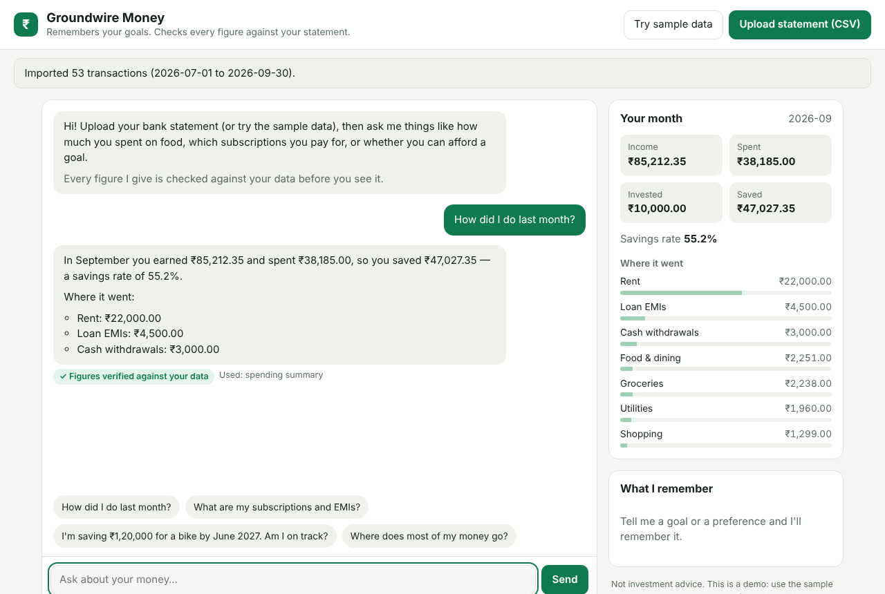

# Groundwire Money

**A personal-finance agent that remembers you, and can't lie about your money.**

Upload a bank statement, then ask in plain words: *How did I do last month? What
are my subscriptions? Can I afford a ₹1,20,000 bike by June?* The agent answers
from your own transactions, remembers your goals and preferences across
conversations, and **every figure in every answer is checked against your data
before you see it.**



## Why this exists

Money apps that use AI have two problems:

1. **AI gives a different answer every time, and sometimes a wrong one.** Language
   models are bad at adding up hundreds of transactions, and they state made-up
   numbers confidently.
2. **They forget you.** Every chat starts from zero: your goals, your salary
   date, how you like answers, all gone.

Groundwire Money fixes both:

* **The model never does maths.** Tools compute every figure exactly (integer
  paise, never floating point). Then [Groundwire](../../README.md)'s answer
  check compares every number in the reply with the tool results. A mismatch
  goes back to the model to correct, **before** the user sees anything. If it
  still doesn't match, the answer is clearly flagged (or withheld, if you choose).
* **Long-term memory.** Goals, facts and preferences are stored per user in
  Postgres with vector search, recalled when relevant, and editable or
  deletable by the user at any time.

## What it does

| | |
|---|---|
| **Statement import** | CSV exports from any bank: finds the table under the bank's preamble, matches column names ("Narration", "Withdrawal Amt."...), reads Indian dates and lakh grouping, reports unreadable rows by line number. **Re-uploading never double-counts.** |
| **Categories** | Deterministic rules (Swiggy → food, Instamart → groceries, SIP → investments...), so the same narration always lands in the same category |
| **Insights** | Income, spending, investments, savings rate, categories, month-by-month trends, recurring payments (rent, EMIs, SIPs, subscriptions), savings-goal plans |
| **Agent** | 8 tools, a bounded loop, self-correction when the answer check fails, a ✓ / ⚠ badge on every answer |
| **Memory** | Remember / recall / update / forget, per user, with pgvector similarity search |
| **Safety** | Via Groundwire: personal data (phone, email, card, PAN, Aadhaar) hidden from the model; prompt injection blocked, **including attacks hidden in a statement row** |
| **Boundaries** | Explains your money; never recommends specific stocks, funds or insurance (that is regulated advice in India) |

## Architecture

```
Browser ─► Money Agent API ─────────► Groundwire gateway ─► LLM (Groq, ...)
             │   (stateless,           PII redaction, injection screening,
             │    scale horizontally)  failover, answer check on every reply
             ▼
   Postgres + pgvector
   transactions · memories · conversations
```

Ports and adapters, with the layering enforced by a test
(`tests/unit/test_architecture.py`):

```
core ─► domain ─► statements · insights · memory ─► services ─► agent ─► api
                  adapters implement the domain's ports;  container.py wires everything
```

| Package | Responsibility |
|---|---|
| `domain/` | `Money` (whole paise), entities, and the **ports**: storage, LLM, embedder, clock, identity |
| `statements/` | CSV parser and categoriser (pure; no I/O) |
| `insights/` | Analytics: pure functions, exact arithmetic |
| `memory/` | Embedders and the remember/recall/forget policy |
| `services/` | Use cases: import a statement, answer finance questions |
| `agent/` | Tool framework, the 8 tools, the system prompt, the loop, the conversation use case |
| `adapters/` | Postgres, in-memory, Groundwire HTTP client, demo identity, clock |
| `api/` | FastAPI routes, middleware, schemas, the web page |
| `container.py` | Composition root: the only module that knows the concrete classes |

Rules the code keeps:

* **The app never imports Groundwire's code.** It talks to the gateway over HTTP
  only, so either side can be deployed, scaled or replaced on its own.
* **Every storage call takes `user_id`.** There is no query that can read across
  users. All user routes are `/v1/me/...`, so there is no user id in a URL to
  tamper with.
* **Errors are safe by construction.** Every expected error has a code, an HTTP
  status and a user-safe message. Internal detail (SQL state, upstream text) goes
  to the logs, tied to a request id that also flows into Groundwire's logs.

### Design decisions

| Decision | Why |
|---|---|
| Money as integer paise | `0.1 + 0.2 != 0.3` in floating point, and errors add up over thousands of rows |
| Tools return amounts as `"12450.50"` strings | The model writes `₹12,450.50`, which the answer check reads as the same number |
| The memory tool is called `remember`, not `save_memory` | Otherwise "you **saved** ₹47,027" reads as a claim that a save tool ran (a false positive found while building this) |
| Rule-based categories, not a model | Deterministic, explainable, free at 50,000 rows |
| Default period = latest month **with data** | Someone who uploads September in late October and asks "how am I doing?" means September |
| Exact per-user vector search, no HNSW index | A user has at most a few hundred memories: exact search is fast and never misses; approximate indexes only pay off across all users |
| Keyset pagination | Fast on any page, and never skips or repeats rows when new data arrives |
| Parsing in a worker thread | A 50,000-row upload doesn't block other users' requests |
| Migrations under a Postgres advisory lock | Ten replicas starting at once apply each migration exactly once |
| Answer check in `flag` mode at the gateway | The agent reads the verdict and self-corrects; a hard block would stop that |

## Scaling and fault tolerance

* **Stateless app:** all state is in Postgres, so you can run any number of
  replicas (`docker compose up --scale money-agent=3`).
* **Bounded resources:**
  * one connection pool per process;
  * upload size and row limits (the size is checked while reading, so an
    oversized file is refused early);
  * at most 6 model calls per message;
  * a time limit on every tool;
  * tool results capped in size;
  * a cap on memories per user.
* **Failures degrade, they don't crash:**
  * a failing tool becomes an error the model can explain;
  * gateway hiccups are retried (only 429/502/503/504 and connection errors,
    with backoff and jitter, honouring `Retry-After`);
  * if every model is down, Groundwire's backup answers instead of an error;
  * the database being down returns a clean 503, and the readiness probe takes
    the replica out of rotation.

## Run it

**Everything at once (Docker):**

```bash
cd apps/money-agent
GROQ_API_KEY=your-key docker compose up --build    # key optional: without it, the backup model answers
open http://localhost:8100                           # click "Try sample data"
```

**For development:**

```bash
cd apps/money-agent
make install          # app + dev tools + the gateway (for end-to-end tests)
make check            # lint, strict types, tests
make test-pg          # also run the storage contract on Postgres (MONEY_TEST_DATABASE_URL)
```

Settings are environment variables (`MONEY_*`, see `core/config.py`). The main ones:

| Variable | Default | |
|---|---|---|
| `MONEY_STORAGE` | `memory` | `postgres` for anything real |
| `MONEY_DATABASE_URL` | – | Postgres DSN (secret) |
| `MONEY_GATEWAY_URL` | `http://127.0.0.1:8000` | Groundwire |
| `MONEY_EMBEDDER` | `hashing` | `http` for any OpenAI-compatible embeddings API |
| `MONEY_UNVERIFIED_ANSWERS` | `warn` | `withhold` to hide answers that fail the check |

`samples/sample_statement.csv` is **synthetic** data (three months, 53 rows) for
demos and tests.

## Tests

194 tests, **97% line and branch coverage**, strict mypy, all run in CI:

* **Unit:** money, parser (messy real-world formats), categoriser, analytics,
  memory policy, tool framework, agent loop (self-correction, step budget,
  withhold policy), Groundwire client (retries, error mapping), settings, logging.
* **Storage contract:** one suite run against **both** the in-memory adapter and
  **real Postgres + pgvector**, proving the test double behaves like production.
* **API:** uploads, pagination, user isolation, memory, chat with history,
  errors that never leak internals, security headers, request ids.
* **End to end through a real Groundwire gateway** (started as an HTTP server,
  with scripted models):
  * true figures → **verified**;
  * a made-up figure → **caught**;
  * a prompt injection → **refused**;
  * an injection hidden in a bank statement row → **refused**;
  * gateway down → a friendly error.
* **Architecture:** layering and library ownership checked from the imports, so
  no import cycle can come back.

## Limits (honestly)

* **The login is a demo.** The browser sends a random 128-bit id. Real use needs
  real authentication: implement `IdentityProvider` with your OIDC/JWT provider
  (one class; nothing else changes). **Don't put real statements on a public demo.**
* **CSV only.** PDF statements are not parsed yet.
* **The default embedder matches words, not meaning.** It knows "bike" ≈ "bikes",
  not "bike" ≈ "motorcycle". Set `MONEY_EMBEDDER=http` for semantic embeddings.
* **The answer check covers numbers and claimed actions**, not every possible
  free-text claim (see Groundwire's answer-check docs).
* **Not financial advice**, and not a SEBI-registered adviser.
